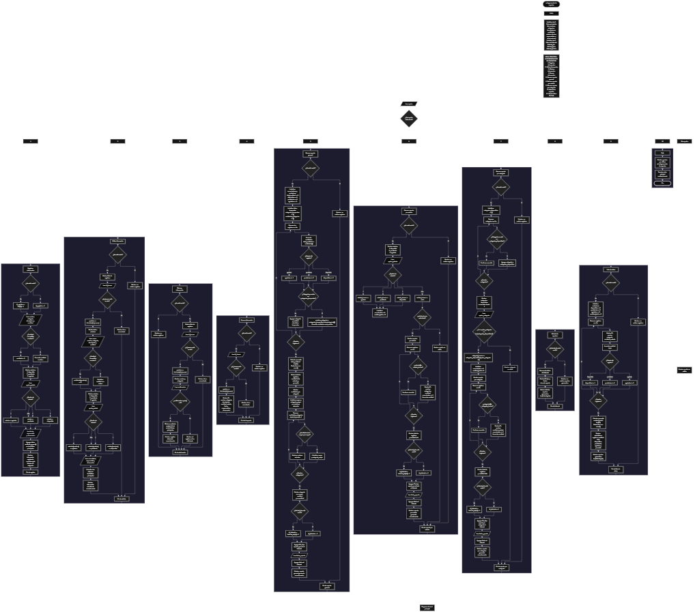

Este proyecto, llamado <b>autogenerador de reportes</b>, fue desarrollado en <b>python</b> como un ejercicio práctico para fortalecer la lógica de programación mediante la creación de un sistema de gestión de información y generación de reportes desde la consola. El programa cuenta con un menú principal de diez opciones que permite <b>registrar, editar, eliminar, buscar y consultar información</b>, además de generar reportes generales, reportes por estado y reportes por categoría. Cada registro almacena datos como el nombre, la categoría, la descripción, la cantidad, el estado, la fecha, el responsable y las observaciones, utilizando listas relacionadas para organizar la información durante la ejecución. También incorpora un historial que permite consultar los reportes generados, conservando su identificador, tipo y fecha. Durante su desarrollo se aplicaron conceptos fundamentales de programación, como variables, listas, estructuras condicionales, ciclos repetitivos, métodos, manejo de excepciones, contadores y acumuladores. Este proyecto permite poner en práctica los conocimientos adquiridos en Python y sirve como base para desarrollar sistemas de gestión y generación de reportes más avanzados utilizando otros lenguajes y tecnologías.

<h2 align="center">⚙️ Funcionamiento del menú principal</h2>

### ➕ Registrar información

La opción <b>1) registrar información</b> permite agregar un nuevo registro al sistema. Primero, el programa comprueba si la lista <b>ids</b> está vacía mediante la condición <b>len(ids) == 0</b>. Si no existen registros, asigna el identificador inicial <b>1</b>; de lo contrario, obtiene el último identificador almacenado y le suma uno utilizando <b>ids[-1] + 1</b>. Después, solicita el nombre, la categoría, la descripción, la cantidad, el estado, la fecha, el responsable y la observación. Para capturar la cantidad utiliza una estructura <b>try/except ValueError</b>, que convierte el dato introducido a un número entero y asigna <b>0</b> si ocurre un error. También presenta tres estados disponibles: <b>disponible, pendiente y agotado</b>. Si se selecciona una opción incorrecta, asigna el estado <b>pendiente</b>. Finalmente, almacena toda la información en sus respectivas listas mediante el método <b>append()</b> y muestra el identificador asignado junto con el mensaje <b>"información registrada correctamente."</b>.

### ✏️ Editar información

La opción <b>2) editar información</b> permite modificar los datos de un registro existente. Primero, el programa comprueba si existen registros almacenados mediante <b>len(ids) == 0</b>. Si no hay información, muestra el mensaje <b>"no existen registros."</b>. En caso contrario, utiliza un ciclo <b>for</b> para mostrar un listado con el identificador, nombre, categoría, cantidad y estado de cada registro. Después, solicita el identificador que se desea modificar y comprueba si existe mediante la condición <b>id_buscar in ids</b>. Si lo encuentra, utiliza <b>ids.index(id_buscar)</b> para obtener su posición y mostrar los datos actuales. A continuación, solicita nuevamente el nombre, la categoría, la descripción, la cantidad, el estado, la fecha, el responsable y la observación, actualizando directamente los valores de las listas correspondientes. La cantidad se convierte a entero mediante <b>try/except ValueError</b> y, si ocurre un error, se asigna <b>0</b>. Si el estado seleccionado no es válido, se establece como <b>pendiente</b>. Finalmente, muestra el mensaje <b>"información actualizada correctamente."</b>. Si el identificador no existe, presenta el mensaje <b>"id no encontrada."</b>.

### 🗑️ Eliminar información

La opción <b>3) eliminar información</b> permite eliminar un registro almacenado en el sistema. Antes de comenzar, el programa comprueba si existen registros. Si la lista está vacía, muestra el mensaje <b>"no existen registros."</b>. Si hay información disponible, presenta un listado con el identificador, nombre, categoría y estado de cada registro. Después, solicita el identificador que se desea eliminar y comprueba si se encuentra en la lista <b>ids</b>. Cuando existe, obtiene su posición mediante <b>ids.index(id_buscar)</b> y muestra el nombre y la categoría correspondientes. A continuación, solicita una confirmación mediante la variable <b>confirmacion</b>. Si la respuesta, convertida a mayúscula con <b>upper()</b>, es igual a <b>"S"</b>, utiliza el método <b>pop(posicion)</b> para eliminar los datos de las nueve listas principales en la misma posición. De esta manera, mantiene relacionadas las posiciones de los registros restantes. Finalmente, muestra el mensaje <b>"registro eliminado correctamente."</b>. Si el usuario no confirma la operación, informa que el registro no fue eliminado. El historial de reportes no se modifica durante este proceso.

### 🔎 Buscar información

La opción <b>4) buscar información</b> permite localizar un registro mediante su identificador. Primero, el programa comprueba si existen registros almacenados. Si no hay información, muestra el mensaje <b>"no existen registros."</b>. En caso contrario, solicita el identificador que se desea buscar y comprueba su existencia mediante la condición <b>id_buscar in ids</b>. Si encuentra una coincidencia, utiliza <b>ids.index(id_buscar)</b> para obtener la posición correspondiente y muestra toda la información del registro: <b>id, nombre, categoría, descripción, cantidad, estado, fecha, responsable y observación</b>. Si el identificador introducido no se encuentra en la lista, presenta el mensaje <b>"id no encontrada."</b>. Esta función permite consultar los datos completos de un registro sin necesidad de recorrer manualmente toda la información.

### 📊 Generar reporte general

La opción <b>5) generar reporte general</b> permite obtener un resumen estadístico de todos los registros almacenados. Primero, comprueba si existen datos. Si no hay registros, muestra el mensaje <b>"no existen registros."</b>. En caso contrario, inicializa diferentes variables acumuladoras y contadoras para calcular la cantidad total y el número de registros disponibles, pendientes y agotados. Mediante un ciclo <b>for</b>, recorre las listas y acumula las cantidades utilizando <b>total_cantidad += cantidades[i]</b>. También comprueba el estado de cada registro para incrementar el contador correspondiente. Para agrupar las cantidades por categoría, utiliza dos listas temporales llamadas <b>categorias_temporales</b> y <b>cantidades_categorias</b>. Si una categoría ya existe, busca su posición con <b>index()</b> y acumula la cantidad correspondiente; si no existe, agrega la categoría y su cantidad mediante <b>append()</b>. Después, muestra el total de registros, la cantidad acumulada, los estados, el promedio de cantidades utilizando <b>round()</b> y la cantidad correspondiente a cada categoría. También recorre las cantidades agrupadas para identificar la <b>categoría con mayor cantidad</b>. Finalmente, genera un identificador para el historial, almacena el tipo <b>"reporte general"</b> y solicita la fecha del reporte, guardándola en las listas correspondientes. Al terminar, muestra el mensaje <b>"reporte general generado correctamente."</b>.

### 📌 Generar reporte por estado

La opción <b>6) generar reporte por estado</b> permite consultar los registros que pertenecen a un estado específico. Primero, comprueba que existan registros almacenados. Después, presenta las opciones <b>disponible, pendiente y agotado</b> para que el usuario seleccione el estado que desea consultar. Mediante estructuras condicionales, asigna el estado seleccionado a la variable <b>estado_buscar</b>. Si la opción introducida no corresponde a ninguna de las alternativas, la variable queda vacía y el programa muestra el mensaje <b>"opción no válida."</b>. Cuando la selección es correcta, inicializa los contadores <b>encontrados</b> y <b>cantidad_total</b>. A continuación, utiliza un ciclo <b>for</b> para recorrer los registros y comparar sus estados con el seleccionado. Cuando encuentra coincidencias, muestra el identificador, nombre, categoría y cantidad de cada registro, incrementa el número de encontrados y acumula sus cantidades. Al finalizar, presenta el total de registros encontrados y la cantidad total correspondiente al estado seleccionado. Finalmente, registra el reporte en el historial con su identificador, tipo <b>"reporte por estado"</b> y fecha introducida por el usuario, mostrando el mensaje <b>"reporte por estado generado correctamente."</b>.

### 🗂️ Generar reporte por categoría

La opción <b>7) generar reporte por categoría</b> permite consultar los registros pertenecientes a una categoría determinada. Primero, comprueba si existen registros almacenados. Si hay información, crea la lista temporal <b>categorias_disponibles</b> y utiliza un ciclo <b>for</b> para recorrer las categorías registradas. Mediante la condición <b>categorias[i] not in categorias_disponibles</b>, evita agregar categorías repetidas y construye una lista con las categorías disponibles. Después, muestra las categorías numeradas para facilitar su selección. El usuario introduce el número de la categoría y el programa comprueba que esté dentro del rango permitido, utilizando las condiciones <b>opcion_categoria &gt;= 1</b> y <b>opcion_categoria &lt;= len(categorias_disponibles)</b>. Si la selección es válida, obtiene la categoría correspondiente mediante su posición y recorre los registros para encontrar las coincidencias. Durante el recorrido, muestra el identificador, nombre, cantidad y estado de cada registro encontrado, además de contar los registros y acumular sus cantidades. Finalmente, presenta los resultados y almacena el reporte en el historial con el tipo <b>"reporte por categoría"</b> y la fecha introducida por el usuario. Si el número seleccionado no corresponde a una categoría disponible, muestra el mensaje <b>"categoría no válida."</b>.

### 📚 Historial de reportes

La opción <b>8) historial de reportes</b> permite consultar los reportes que se han generado durante la ejecución del programa. Primero, comprueba si la lista <b>historial_ids</b> está vacía. Si no existen reportes, muestra el mensaje <b>"no existen reportes generados."</b>. En caso contrario, utiliza un ciclo <b>for</b> para recorrer las tres listas relacionadas del historial y mostrar el identificador, el tipo de reporte y la fecha de generación. Los reportes pueden corresponder a un <b>reporte general, reporte por estado o reporte por categoría</b>. Al finalizar, muestra el total de reportes generados mediante <b>len(historial_ids)</b>. Esta función permite consultar los reportes registrados sin modificar la información principal del sistema.

### 📋 Lista de datos

La opción <b>9) lista de datos</b> permite visualizar un resumen de los registros almacenados y sus principales estadísticas. Primero, comprueba si existen registros. Si la lista está vacía, muestra el mensaje <b>"no existen registros."</b>. Si hay información disponible, inicializa los contadores <b>disponibles, pendientes y agotados</b>, además de la variable acumuladora <b>cantidad_total</b>. Después, utiliza un ciclo <b>for</b> para recorrer los registros y mostrar el identificador, nombre, categoría, cantidad y estado de cada uno. Durante el recorrido, acumula las cantidades y comprueba el estado de cada registro para incrementar el contador correspondiente. Al finalizar, presenta las estadísticas generales: total de registros, cantidad total, número de registros por estado, promedio de cantidades y total de reportes generados. Para calcular el promedio utiliza la división de la cantidad total entre el número de registros y redondea el resultado mediante <b>round()</b>. Esta opción permite consultar de manera organizada la información almacenada y conocer el estado general de los registros.

### 🚪 Salir del menú principal

La opción <b>10) salir</b> permite finalizar la ejecución del programa. Cuando el usuario selecciona esta opción, el sistema muestra el mensaje <b>"gracias por utilizar el autogenerador de reportes."</b> y utiliza la instrucción <b>break</b> para interrumpir el ciclo <b>while True</b>. De esta manera, finaliza el menú principal y termina la ejecución del programa.

<h2 align="center">🧠 Temas aplicados en el proyecto</h2>

### 📦 Variables

En este proyecto se utilizan variables para almacenar la información de los registros, controlar las opciones del menú, identificar los datos que se desean modificar o consultar, seleccionar estados y categorías, realizar cálculos estadísticos y llevar el control de los reportes generados. También se utilizan variables temporales, contadores y acumuladores para organizar los procesos de generación de reportes.

🔢 **Opcion:** Almacena la opción seleccionada por el usuario en el menú principal.

🆔 **Id_registro:** Almacena el identificador asignado al nuevo registro.

🔎 **Id_buscar:** Almacena el identificador que se desea buscar, editar o eliminar.

📍 **Posicion:** Guarda la posición correspondiente al registro encontrado dentro de las listas.

📦 **Cantidad:** Almacena la cantidad introducida durante el registro de información.

📊 **Total_cantidad:** Acumula las cantidades de los registros durante la generación del reporte general.

📈 **Promedio:** Almacena el resultado del cálculo del promedio de cantidades.

📌 **Disponibles, pendientes y agotados:** Funcionan como contadores para registrar cuántos elementos pertenecen a cada estado.

🗂️ **Estado_buscar:** Almacena el estado seleccionado para generar un reporte específico.

📋 **Categoria_buscar:** Almacena la categoría seleccionada para generar un reporte por categoría.

🔄 **Encontrados:** Cuenta los registros que coinciden con el estado o la categoría seleccionada.

🧾 **Id_historial:** Almacena el identificador asignado a cada reporte generado.

📅 **Fecha_reporte:** Almacena la fecha introducida para registrar la generación de un reporte.

### 🗃️ Listas principales

En este proyecto se utilizan nueve listas principales relacionadas entre sí para almacenar la información de los registros. Todas mantienen la misma cantidad de elementos y utilizan el mismo índice para representar los datos correspondientes a un mismo registro. Por ejemplo, la información ubicada en la posición <b>0</b> de cada lista pertenece al mismo elemento. Esta organización permite registrar, editar, buscar, mostrar y eliminar información manteniendo la relación entre sus datos.

🆔 **Ids:** Almacena los identificadores de los registros.

📝 **Nombres:** Almacena los nombres de los registros.

🗂️ **Categorias:** Almacena las categorías correspondientes a cada registro.

📄 **Descripciones:** Almacena las descripciones de los registros.

🔢 **Cantidades:** Almacena las cantidades asociadas a cada registro.

📌 **Estados:** Almacena los estados disponibles, pendientes o agotados.

📅 **Fechas:** Almacena las fechas correspondientes a los registros.

👤 **Responsables:** Almacena los responsables de cada registro.

📋 **Observaciones:** Almacena las observaciones adicionales.

### 📚 Listas del historial

Además de las listas principales, el programa utiliza tres listas relacionadas para almacenar el historial de los reportes generados. Estas listas mantienen la información de cada reporte mediante la misma posición, permitiendo consultar su identificador, tipo y fecha de generación. El historial funciona de manera independiente de los registros principales, por lo que eliminar un registro no modifica los reportes que ya fueron almacenados.

🆔 **Historial_ids:** Almacena los identificadores de los reportes generados.

📊 **Historial_tipos:** Almacena el tipo de reporte, que puede ser general, por estado o por categoría.

📅 **Historial_fechas:** Almacena las fechas de generación de los reportes.

### 🔀 Estructuras condicionales

En este proyecto se utilizan las estructuras <b>if, elif y else</b> para controlar las diferentes decisiones del programa. Permiten comprobar si existen registros antes de realizar una operación, verificar si un identificador está almacenado, determinar el estado seleccionado, validar la categoría elegida, identificar registros que coinciden con los criterios de los reportes y comprobar la confirmación antes de eliminar información. Estas condiciones permiten ejecutar diferentes instrucciones según los datos introducidos por el usuario y los resultados obtenidos durante cada proceso.

### 🔄 Estructuras repetitivas

En este proyecto se utilizan los ciclos <b>while</b> y <b>for</b>. El ciclo <b>while True</b> mantiene activo el menú principal y permite que el usuario realice diferentes operaciones hasta seleccionar la opción de salida. Por otra parte, los ciclos <b>for</b> permiten recorrer las listas para mostrar los registros, buscar información, identificar categorías repetidas, generar reportes, acumular cantidades y calcular estadísticas. Estos ciclos facilitan trabajar con todos los elementos almacenados sin tener que realizar las operaciones individualmente.

### 🧰 Métodos y funciones de Python

El programa utiliza diferentes funciones y métodos integrados de Python para administrar las listas, realizar comprobaciones y calcular resultados. Entre ellos se encuentran <b>input()</b> y <b>print()</b> para la interacción con el usuario; <b>len()</b> para conocer la cantidad de elementos; <b>append()</b> para agregar información; <b>pop()</b> para eliminar registros; <b>index()</b> para obtener la posición de un elemento; <b>upper()</b> para convertir la confirmación a mayúsculas; y <b>round()</b> para redondear los promedios. También se utilizan las operaciones <b>in</b> y <b>not in</b> para comprobar la existencia de elementos dentro de las listas.

### ⚠️ Manejo de excepciones

El programa utiliza la estructura <b>try/except ValueError</b> durante el registro y la edición de información para controlar los errores que pueden producirse al convertir la cantidad introducida por el usuario a un número entero mediante <b>int()</b>. Si el valor no puede convertirse, se captura la excepción <b>ValueError</b> y se asigna el valor <b>0</b> a la cantidad. Esto permite continuar con el proceso sin interrumpir la ejecución del programa por un error en ese dato.

### 🔢 Contadores y acumuladores

Los contadores y acumuladores permiten realizar los cálculos necesarios para generar los reportes y mostrar las estadísticas del sistema. Los contadores registran cuántos elementos pertenecen a determinados estados o cumplen una condición, mientras que los acumuladores suman las cantidades almacenadas en los registros. Estos recursos se utilizan principalmente en los reportes generales, por estado, por categoría y en la lista de datos.

📊 **Total_cantidad:** Acumula las cantidades de todos los registros.

📌 **Disponibles, pendientes y agotados:** Cuentan los registros según su estado.

🔎 **Encontrados:** Cuenta los registros que coinciden con el criterio de búsqueda del reporte.

🗂️ **Cantidades_categorias:** Acumula las cantidades correspondientes a cada categoría.

📈 **Promedio:** Se obtiene dividiendo la cantidad total entre el número de registros.

### 🗂️ Agrupación de información por categoría

El programa utiliza las listas temporales <b>categorias_temporales</b> y <b>cantidades_categorias</b> para agrupar las cantidades correspondientes a cada categoría durante la generación del reporte general. Primero, comprueba si la categoría del registro ya se encuentra almacenada en la lista temporal. Si existe, obtiene su posición mediante <b>index()</b> y suma la cantidad correspondiente en <b>cantidades_categorias</b>. Si no existe, agrega la categoría y su cantidad a las listas utilizando <b>append()</b>. Esta organización permite calcular el total acumulado de cada categoría y determinar cuál presenta la mayor cantidad.

### 🔢 Generación de identificadores

El programa genera identificadores automáticamente para los registros y los reportes. Para los registros, comprueba si la lista <b>ids</b> está vacía y asigna el valor <b>1</b>; si ya existen elementos, toma el último identificador y le suma uno. Para los reportes, aplica el mismo procedimiento utilizando la lista <b>historial_ids</b>. De esta manera, cada nuevo registro y cada reporte generado recibe un identificador que permite diferenciarlo dentro de su respectiva lista.

<h2 align="center">¿Cómo se implementaron las operaciones crud en el proyecto?</h2>

Las operaciones <b>crud</b> se implementaron mediante las opciones del menú principal, permitiendo administrar la información almacenada. La operación <b>crear</b> corresponde a <b>registrar información</b>, donde se capturan los datos de un nuevo registro y se almacenan en las listas principales. La operación <b>leer</b> se realiza mediante las opciones <b>buscar información y lista de datos</b>, que permiten consultar los registros almacenados. La operación <b>actualizar</b> corresponde a <b>editar información</b>, donde se modifican los datos de un registro existente. Finalmente, la operación <b>eliminar</b> se realiza mediante <b>eliminar información</b>, que permite borrar los datos de un registro previa confirmación del usuario. Estas operaciones utilizan listas relacionadas, condicionales, ciclos y métodos de Python para administrar la información durante la ejecución del programa.

<h2 align="center">Diagrama de flujo del proyecto</h2>

<h2 align="center">🛡️ Validaciones del programa</h2>

### 📭 No existen registros

Esta validación se utiliza en las opciones de <b>editar, eliminar, buscar, generar reportes y lista de datos</b>. El programa comprueba si la lista <b>ids</b> está vacía mediante la condición <b>len(ids) == 0</b>. Si no existen registros almacenados, muestra el mensaje <b>"no existen registros."</b> y evita continuar con las operaciones que necesitan información disponible.

### ❌ Identificador no encontrado

Esta validación se utiliza durante las operaciones de <b>editar, eliminar y buscar información</b>. El programa comprueba si el identificador introducido se encuentra en la lista <b>ids</b> mediante la condición <b>id_buscar in ids</b>. Si existe, obtiene su posición utilizando <b>index()</b> y continúa con la operación correspondiente. Si no encuentra el identificador, muestra el mensaje <b>"id no encontrada."</b>.

### 🔢 Conversión de cantidades

Esta validación se utiliza durante el registro y la edición de información. El programa intenta convertir el valor introducido por el usuario a un número entero mediante <b>int()</b>. Si el dato no puede convertirse, la estructura <b>except ValueError</b> captura el error y asigna el valor <b>0</b> a la cantidad. De esta manera, el programa puede continuar con el registro o la actualización de información.

### 📌 Selección de estados

Esta validación se utiliza durante el registro, la edición y la generación de reportes por estado. El programa presenta tres alternativas: <b>disponible, pendiente y agotado</b>. Mediante estructuras condicionales comprueba la opción seleccionada y asigna el estado correspondiente. Si el usuario introduce una opción incorrecta durante el registro o la edición, el sistema establece automáticamente el estado <b>pendiente</b>. En el reporte por estado, una selección incorrecta deja vacía la variable <b>estado_buscar</b> y muestra el mensaje <b>"opción no válida."</b>.

### 🗂️ Categorías sin repetir

Esta validación se utiliza durante la generación del reporte por categoría. El programa recorre las categorías registradas y comprueba si cada una ya se encuentra en la lista <b>categorias_disponibles</b> mediante la condición <b>categorias[i] not in categorias_disponibles</b>. Si todavía no existe, la agrega a la lista. Esto evita mostrar categorías repetidas y permite presentar una lista organizada para que el usuario seleccione la que desea consultar.

### 🔢 Selección de categoría

Esta validación se utiliza durante la generación del reporte por categoría. El programa comprueba que el número introducido sea mayor o igual a <b>1</b> y menor o igual a la cantidad de categorías disponibles. Si la selección se encuentra dentro del rango permitido, obtiene la categoría correspondiente y genera el reporte. Si el número no corresponde a una categoría disponible, muestra el mensaje <b>"categoría no válida."</b>.

### ❓ Confirmación de eliminación

Esta validación se utiliza antes de eliminar un registro. El programa solicita una respuesta mediante la variable <b>confirmacion</b> y utiliza el método <b>upper()</b> para convertirla a mayúsculas. Si el resultado es igual a <b>"S"</b>, elimina los datos de las nueve listas principales utilizando <b>pop()</b>. Si la respuesta es diferente, conserva la información y muestra el mensaje <b>"el registro no fue eliminado."</b>.

### 📚 Historial de reportes vacío

Esta validación se utiliza en la opción <b>historial de reportes</b>. El programa comprueba si la lista <b>historial_ids</b> está vacía mediante la condición <b>len(historial_ids) == 0</b>. Si no existen reportes generados, muestra el mensaje <b>"no existen reportes generados."</b>. Si hay información, recorre las listas del historial y presenta los identificadores, tipos y fechas correspondientes.

### ⚠️ Opción inválida

El menú principal utiliza una estructura condicional <b>if, elif y else</b> para comprobar la opción introducida por el usuario. Si el valor no coincide con ninguna de las diez opciones disponibles, se ejecuta el bloque <b>else</b> y se muestra el mensaje <b>"opción no válida."</b>. Esta comprobación también permite controlar las opciones incorrectas en los procesos de selección de estado y categoría.

### ⚠️ Conversión de identificadores y categorías

En las opciones de <b>editar, eliminar y buscar información</b>, el programa utiliza <b>int(input())</b> para convertir el identificador introducido a un número entero. De manera similar, durante la generación del reporte por categoría, utiliza <b>int(input())</b> para convertir la selección de la categoría. Estas conversiones no cuentan con una estructura <b>try/except</b>, por lo que introducir texto u otros valores no convertibles puede generar un error <b>ValueError</b> e interrumpir la ejecución del programa.

<h2 align="center">🎯 Objetivo del proyecto</h2>

El objetivo principal de este proyecto es fortalecer la <b>lógica de programación</b> mediante el desarrollo de un sistema de gestión de información y generación de reportes en <b>python</b>. A través de su construcción se busca aplicar los conocimientos adquiridos sobre variables, listas, estructuras condicionales, ciclos repetitivos, métodos, manejo de excepciones, contadores y acumuladores, integrándolos para resolver un problema de manera organizada. Además, el proyecto permite comprender cómo registrar, consultar, modificar y eliminar información, así como procesar datos para generar reportes estadísticos, agrupar cantidades por categoría y consultar un historial de reportes. De esta manera, se establece una base para desarrollar sistemas de gestión y análisis de información más completos utilizando otros lenguajes y tecnologías.

